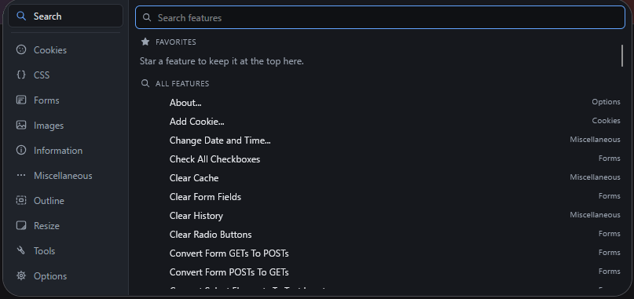
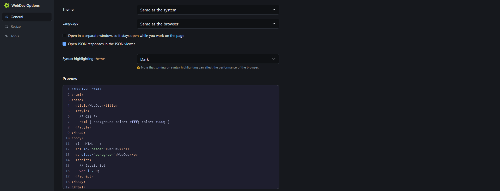

<div align="center">

<h1> WebDev &nbsp; <a href="https://addons.mozilla.org/ru/firefox/addon/webdev/"></a></h1>

<a href="#english"></a>
<a href="license.txt"></a>


<br>


<br>


**A toolbar full of web developer tools for Chrome, Edge and Firefox.**

> Modern **Manifest V3** fork of [chrispederick/web-developer](https://github.com/chrispederick/web-developer),
> rebuilt with TypeScript, Svelte and [WXT](https://wxt.dev).

</div>

<div align="center">

🇬🇧 [English](#english) · 🇷🇺 [Русский](#русский)

</div>

---

## English

> [!NOTE]
> WebDev is live on [addons.mozilla.org](https://addons.mozilla.org/ru/firefox/addon/webdev/) —
> install it there for a permanent, signed copy. The zip in [Releases](../../releases) is still
> there for Chrome/Edge, and as a Firefox temporary add-on.

Click the toolbar button and you get some 120 tools for the page in front of you: outline
and inspect elements, switch styles off, edit CSS live, fill and unlock forms, find broken
images, read cookies and response headers, resize the window to a device, and much more.

<table>
  <tr>
    <td width="25%"></td>
    <td width="25%"></td>
  </tr>
</table>

### Features

- **Search first** — the popup opens on a search box over every tool; type a few letters,
  pick with <kbd>↑</kbd> <kbd>↓</kbd> and run with <kbd>Enter</kbd>
- **Favorites** — star any tool and it stays at the top of Search
- **Ten menus** — Cookies, CSS, Forms, Images, Information, Miscellaneous, Outline, Resize,
  Tools and Options, grouped into toggles, actions, reports and dialogs
- **JSON viewer** — JSON responses open as a collapsible tree with search, copy value /
  copy path, pretty and raw views and download; or paste JSON into it
- **Time travel** — fake the date, time and time zone the page's JavaScript sees
  (`Date`, `Intl.DateTimeFormat`, `Temporal.Now`), with a stop-the-clock switch
- **Live CSS editing**, ruler, line guides, color picker and element information
  right on the page
- **Dark theme** — follows the system, or pick light / dark yourself
- **Languages** — English, Русский and Português; follows the browser or set it in Options
- Optional **popup in a window**, so it stays open while you work on the page
- No data collected, nothing sent anywhere

> [!NOTE]
> WebDev is **100% local**. It has no account, no analytics and no telemetry; everything it
> reads from a page stays on your device.

### Install

| Browser            | Link                                                                                                             |
| ------------------ | ---------------------------------------------------------------------------------------------------------------- |
| Firefox            | [addons.mozilla.org/firefox/addon/webdev](https://addons.mozilla.org/ru/firefox/addon/webdev/)                   |
| Chrome / Edge 111+ | Download the zip from [Releases](../../releases), unzip → `chrome://extensions` → Developer mode → Load unpacked |

> [!TIP]
> Firefox has its own JSON viewer, which takes JSON pages first. To open them in WebDev's
> viewer instead, set `devtools.jsonview.enabled` to `false` in `about:config`. The popup's
> **View JSON** works either way.
>
> The signed `.xpi` from [Releases](../../releases) and the unsigned Firefox zip (unzip, then
> `about:debugging` → This Firefox → Load Temporary Add-on → pick `manifest.json`) still work
> too, if you'd rather not go through AMO.

### Develop

Requires Node.js. The toolchain is [WXT](https://wxt.dev).

```bash
npm install          # also runs `wxt prepare`
npm run dev          # Chrome, with auto-reload
npm run dev:firefox  # Firefox, with auto-reload
```

```bash
npm test             # vitest
npm run typecheck
npm run lint
```

`tools/smoke-serve.py` serves a build over HTTP with the browser APIs stubbed, to check that
the pages load and wire up without installing the extension.

### Build

```bash
npm run build            # -> .output/chrome-mv3
npm run build:firefox    # -> .output/firefox-mv3
npm run zip              # zipped artifact for the Chrome Web Store
npm run zip:firefox      # zipped artifact for AMO
```

Load unpacked from `.output/chrome-mv3` (`chrome://extensions`, Developer mode → Load
unpacked) or `.output/firefox-mv3` (`about:debugging` → This Firefox → Load Temporary
Add-on → pick `manifest.json`).

To release, bump `version` in `package.json`, commit, and push a matching tag. The
[Release workflow](.github/workflows/release.yml) checks, builds and publishes both zips:

```bash
git tag v1.0.1
git push --tags
```

### Project layout

- `src/entrypoints/` — WXT entrypoints: popup, options, about, the JSON viewer, the report
  pages, the content scripts and the background worker
- `src/features/` — the feature registry and the bundles injected into pages
- `src/content/` — what the content script reads from a page for the reports
- `src/lib/` — storage, i18n, theme, the JSON and time travel models
- `src/legacy/` — upstream code still being ported to TypeScript
- `src/public/` — static assets: locales, icons, feature stylesheets, vendored libraries
- `tools/` — build checks and one-off scripts; `tests/` — vitest

> [!IMPORTANT]
> The rebuild is incremental: the extension stays usable at every step while the remaining
> upstream code in `src/legacy/` is ported. [CLAUDE.md](CLAUDE.md) has the details and the
> traps.

### License

[GPL-3.0](license.txt) © 2026 tglagcs, as required by the upstream project. The included
libraries and icons keep their own licenses: [Bootstrap](https://getbootstrap.com/),
[CodeMirror](https://codemirror.net/), [DOMPurify](https://github.com/cure53/DOMPurify),
[JS Beautifier](https://github.com/beautify-web/js-beautify),
[mustache.js](https://github.com/janl/mustache.js/),
[Eric Meyer's Reset CSS](https://meyerweb.com/eric/tools/css/reset/) and
[Nucleo](https://nucleoapp.com) icons.

### Credits

Original extension by Chris Pederick — [chrispederick/web-developer](https://github.com/chrispederick/web-developer).
WebDev is not endorsed by or affiliated with him; see [notice.md](notice.md).

---

## Русский

> [!NOTE]
> WebDev уже доступен на [addons.mozilla.org](https://addons.mozilla.org/ru/firefox/addon/webdev/) —
> ставьте оттуда для постоянной подписанной копии. Zip в [Releases](../../releases) остаётся
> для Chrome/Edge и как временное дополнение для Firefox.

Нажмите кнопку на панели — и у вас около 120 инструментов для открытой страницы: обвести и
изучить элементы, отключить стили, править CSS вживую, заполнить и разблокировать формы,
найти битые картинки, посмотреть cookies и заголовки ответа, подогнать окно под устройство и
многое другое.

<table>
  <tr>
    <td width="25%"></td>
    <td width="25%"></td>
  </tr>
</table>

### Возможности

- **Сначала поиск** — попап открывается с поиском по всем инструментам; наберите пару букв,
  выберите <kbd>↑</kbd> <kbd>↓</kbd> и запустите <kbd>Enter</kbd>
- **Избранное** — отметьте инструмент звёздочкой, и он будет наверху в поиске
- **Десять меню** — Cookies, CSS, Формы, Изображения, Информация, Разное, Контуры, Размер,
  Инструменты и Настройки, с разбивкой на переключатели, действия, отчёты и диалоги
- **Просмотр JSON** — JSON-ответы открываются деревом с поиском, копированием значения и
  пути, форматированным и исходным видом и скачиванием; JSON можно и просто вставить
- **Путешествие во времени** — подмена даты, времени и часового пояса для JavaScript
  страницы (`Date`, `Intl.DateTimeFormat`, `Temporal.Now`), с остановкой часов
- **Правка CSS вживую**, линейка, направляющие, пипетка и информация об элементе прямо на
  странице
- **Тёмная тема** — как в системе или светлая / тёмная на выбор
- **Языки** — English, Русский и Português; как в браузере или на выбор в настройках
- Опционально **попап в отдельном окне**, чтобы он не закрывался, пока вы работаете со
  страницей
- Данные не собираются и никуда не отправляются

> [!NOTE]
> WebDev работает **полностью локально**: без аккаунтов, аналитики и телеметрии. Всё, что он
> читает со страницы, остаётся на вашем устройстве.

### Установка

| Браузер            | Ссылка                                                                                                                    |
| ------------------ | ------------------------------------------------------------------------------------------------------------------------- |
| Firefox            | [addons.mozilla.org/ru/firefox/addon/webdev](https://addons.mozilla.org/ru/firefox/addon/webdev/)                         |
| Chrome / Edge 111+ | Скачай zip из [Releases](../../releases), распакуй → `chrome://extensions` → Режим разработчика → Загрузить распакованное |

> [!TIP]
> В Firefox есть свой просмотрщик JSON, который перехватывает JSON-страницы первым. Чтобы они
> открывались в WebDev, выставьте `devtools.jsonview.enabled` в `false` в `about:config`.
> Пункт **Просмотр JSON** в попапе работает в любом случае.
>
> Подписанный `.xpi` из [Releases](../../releases) и обычный zip для Firefox (распакуй →
> `about:debugging` → Этот Firefox → Загрузить временное дополнение → выбери `manifest.json`)
> тоже работают, если не хочется через AMO.

### Разработка

Требуется Node.js. Инструментарий — [WXT](https://wxt.dev).

```bash
npm install          # также запускает `wxt prepare`
npm run dev          # Chrome, с авто-перезагрузкой
npm run dev:firefox  # Firefox, с авто-перезагрузкой
```

```bash
npm test             # vitest
npm run typecheck
npm run lint
```

### Сборка

```bash
npm run build            # -> .output/chrome-mv3
npm run build:firefox    # -> .output/firefox-mv3
npm run zip              # zip для Chrome Web Store
npm run zip:firefox      # zip для AMO
```

Для релиза поднимите `version` в `package.json`, закоммитьте и запушьте тег с той же версией.
[Release workflow](.github/workflows/release.yml) проверит, соберёт и опубликует оба zip:

```bash
git tag v1.0.1
git push --tags
```

### Лицензия

[GPL-3.0](license.txt) © 2026 tglagcs, как того требует исходный проект. Встроенные
библиотеки и иконки распространяются под своими лицензиями (см. английский раздел).

### Благодарности

Оригинальное расширение — Chris Pederick, [chrispederick/web-developer](https://github.com/chrispederick/web-developer).
WebDev не связан с автором и не одобрен им; подробности в [notice.md](notice.md).
